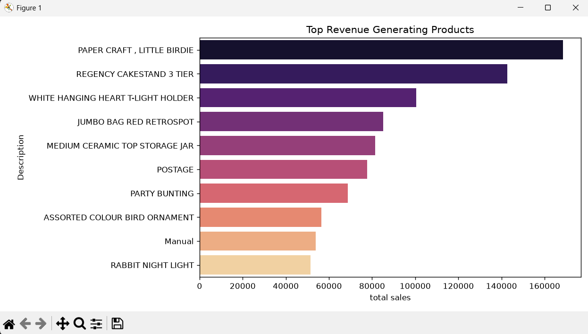
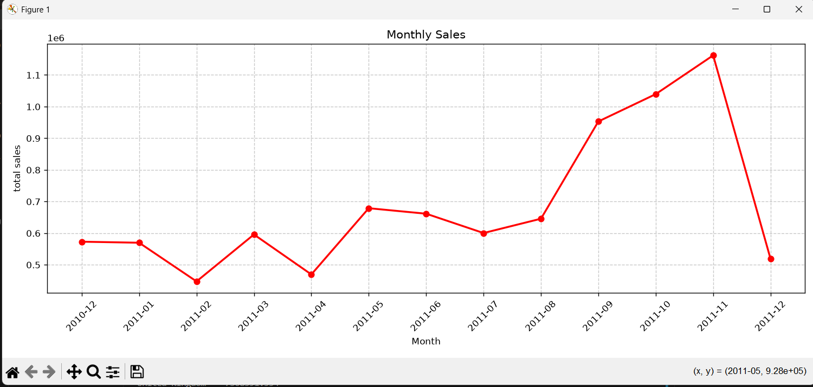
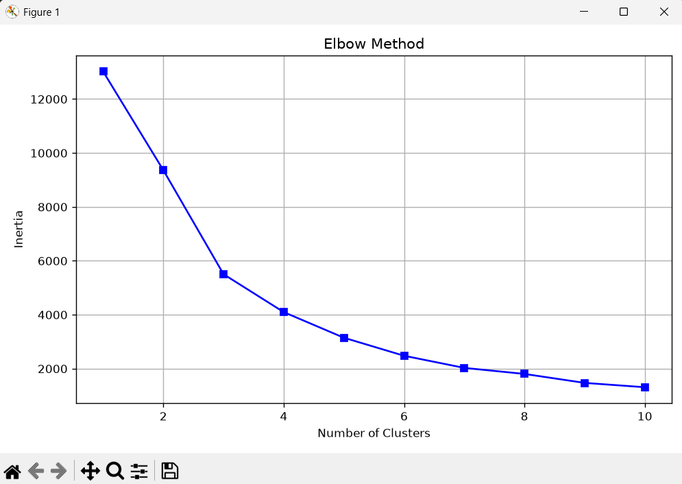
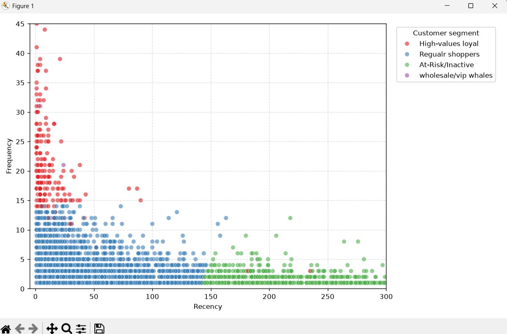
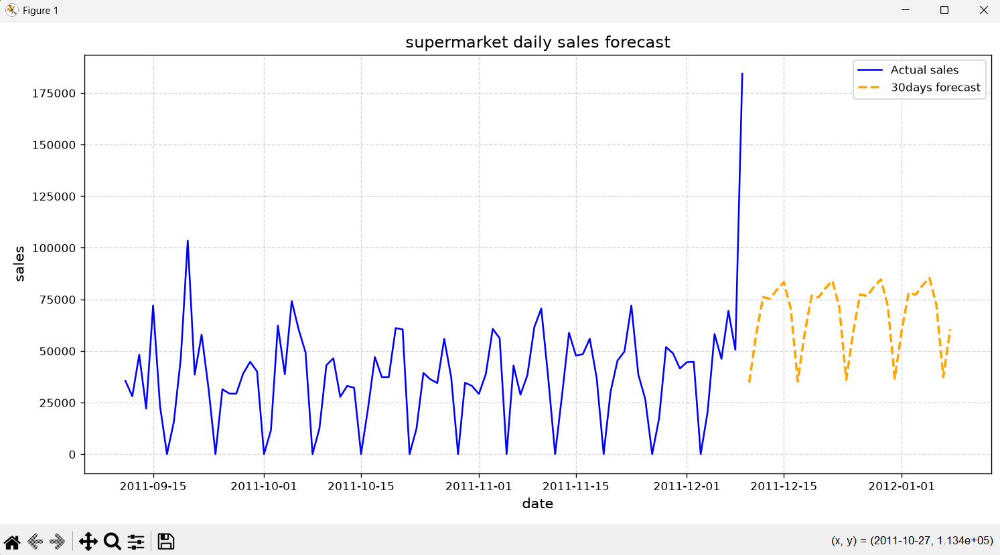

# Supermarket Customer Purchase & Sales Analysis 🛒

A complete Data Science and Machine Learning mini project analyzing supermarket purchase behavior, product relationships, customer groups, and future revenue trends.

---

## 📌 Project Objectives
This project answers three main questions for a store manager:
1. **What items do customers buy together?** (Market Basket Analysis for combo offers and shelf layouts).
2. **Who are our best and worst customers?** (Customer Segmentation using RFM scores + K-Means Clustering).
3. **What will our daily sales look like next month?** (Time Series Forecasting using Holt-Winters Exponential Smoothing).

---

## 📂 Project Structure

```text
minipy/
├── online+retail/
│   └── Online Retail.xlsx        # Raw supermarket dataset (~540,000 rows)
├── Cleaned_Dataset.csv           # Cleaned dataset without returns/errors (397,884 rows)
├── outputs/                      # Saved charts and visualizations
│   ├── top_products_revenue.png  # Top 10 revenue-generating products
│   ├── monthly_sales_trend.png   # Monthly sales trend (2010 - 2011)
│   ├── elbow_method.png          # Elbow curve for optimal K clusters
│   ├── customer_segments.png     # Scatter plot of customer groups
│   └── sales_forecast.png        # 30-day future sales prediction
├── DataClean.py                  # Step 1: Cleaning & preprocessing
├── eda.py                        # Step 2: Exploratory Data Analysis & plots
├── market_basket.py              # Step 3: Association rules with Apriori
├── clustering.py                 # Step 4: RFM calculation & K-Means clustering
└── time_series.py                # Step 5: Holt-Winters sales forecasting
```

---

## 🔬 Project Phases & Results

### 1. Data Cleaning (`DataClean.py`)
- Removed cancelled orders and return transactions (`Quantity <= 0`).
- Removed invalid/damaged price adjustments (`UnitPrice <= 0`).
- Removed anonymous purchases (`CustomerID` is null).
- Added `TotalPrice = Quantity * UnitPrice`.
- **Result:** Data shrunk from **541,909** raw records to **397,884** clean records.

---

### 2. Exploratory Data Analysis (`eda.py`)
- **Main Market:** Over **85%** of all revenue comes from the **United Kingdom** (£7.3M+). Other top countries include the Netherlands, Ireland, Germany, and France.
- **Top Products:** The highest revenue comes from party decor items, cake stands, and lights.
- **Seasonal Trend:** Sales spike significantly in **November 2011** (£1.1M+) due to holiday shopping.

#### Charts:
| Top Products by Revenue | Monthly Sales Trend |
| :---: | :---: |
|  |  |

---

### 3. Market Basket Analysis (`market_basket.py`)
Using the **Apriori Algorithm** on transaction baskets:
- **`Support`**: How often items appear together in carts.
- **`Confidence`**: Chance that a person buys Item B given they bought Item A.
- **`Lift`**: How much stronger the connection is compared to pure chance (Lift > 1 = strong relationship).

#### Top Discovered Rules:
1. **`Pack of 6 Skull Paper Plates` $\rightarrow$ `Pack of 6 Skull Paper Cups`**
   - **Lift = 14.15**, **Confidence = 90.9%**
2. **`Childrens Cutlery Spaceboy` $\rightarrow$ `Childrens Cutlery Dolly Girl`**
   - **Lift = 12.86**, **Confidence = 92.6%**
- **Actionable Insight:** Place matching cups and plates on the same shelf, or bundle them as party kits with a 10% discount.

---

### 4. Customer Segmentation (`clustering.py`)
Each customer was given 3 RFM scores:
- **R (Recency):** Days since their last purchase (lower is better).
- **F (Frequency):** Number of distinct orders made (higher is better).
- **M (Monetary):** Total money spent in £ (higher is better).

We scaled the data using `StandardScaler` and used the **Elbow Method** to choose **$k = 4$ clusters**:

| Elbow Method Curve | Customer Segments Scatter Plot |
| :---: | :---: |
|  |  |

#### Customer Groups Summary:
| Cluster | Group Name | Recency (Avg) | Frequency (Avg) | Monetary (Avg) | Customer Count | Marketing Strategy |
| :---: | :--- | :---: | :---: | :---: | :---: | :--- |
| **0** | **Regular Shoppers** | 44 days | 3.7 orders | £1,359 | 3,054 (70%) | Seasonal promotions & reward points |
| **1** | **At-Risk / Inactive** | 248 days | 1.6 orders | £480 | 1,067 (25%) | Send "We miss you" discount vouchers |
| **2** | **Wholesale / VIP Whales** | 7 days | 82.5 orders | £127,338 | 13 (<1%) | Dedicated VIP manager, priority shipping |
| **3** | **High-Value Loyal** | 16 days | 22.3 orders | £12,709 | 204 (5%) | Premium club benefits & early discounts |

---

### 5. Sales Forecasting (`time_series.py`)
- We grouped total store revenue by calendar day.
- We trained a **Holt-Winters Exponential Smoothing** model with 7-day weekly seasonality (`seasonal_periods=7`).
- **Result:** The model successfully learns the weekly store heartbeat (low/zero weekend sales vs. weekday shopping surges) and projects daily revenue for the next 30 days.



---

## 💻 Tech Stack
- **Python 3.12**
- **Data Handling:** `pandas`, `numpy`, `openpyxl`
- **Charts:** `matplotlib`, `seaborn`
- **Machine Learning:** `scikit-learn` (StandardScaler, KMeans), `mlxtend` (Apriori, Association Rules)
- **Time Series Forecasting:** `statsmodels` (ExponentialSmoothing)

---

## 🏃 How to Run
```powershell
# 1. Activate virtual environment
.venv\Scripts\activate

# 2. Run the scripts in order
python DataClean.py
python eda.py
python market_basket.py
python clustering.py
python time_series.py
```
